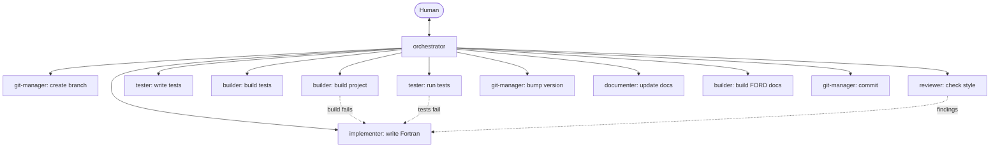

> **AI Generated**

# Fortran Neural Network

A neural network library implemented in modern **Fortran** (Fortran 2008),
built with `gfortran` and driven by a plain `make` workflow. The project is
developed through a structured, role-based multi-agent workflow (see
[Agent Workflow](#agent-workflow)).

> **Status:** The repository conventions, build layout, and agent workflow are
> defined in [`AGENTS.md`](AGENTS.md). Library sources live under [`src/`](src)
> and follow the style rules described below.

## Features

- **Modern Fortran (F2008)** implementation — modular, `implicit none`
  everywhere, encapsulated modules with explicit public APIs.
- **Composable network building blocks** — layers, weight matrices, and
  activation functions assembled into feed-forward networks.
- **Configurable training** — tunable optimisation with clear, named
  constants instead of magic numbers.
- **Deterministic, automated tests** — standalone test programs that exit
  non-zero on failure, discovered automatically by the build.
- **Two build profiles** — an optimized `release` build and a fully checked
  `debug` build (bounds checking plus extra warnings).
- **Semantic versioning** with a per-version changelog under [`docs/`](docs).

## Architecture

The code follows a modular layout where each module lives in its own
free-form `.f90` file named after the module it contains:

```
Fortran-Neural-Network/
├── src/          # Fortran library sources (one module per file)
├── tests/        # Standalone test programs: test_<topic>.f90
├── docs/         # Design docs + CHANGELOG.md (per-version entries)
├── build/        # Generated artifacts (never committed)
├── Makefile      # release / debug / test / docs / clean targets
├── VERSION       # semantic version (MAJOR.MINOR.PATCH)
└── AGENTS.md     # Project conventions, source of truth for all agents
```

### Design principles

- **Encapsulation** — every module is `private` by default and re-exports only
  what belongs in its public API via an explicit `public :: ...` statement.
- **Explicit data flow** — all dummy arguments carry an explicit `intent(...)`.
- **Typed structures** — domain concepts are modelled as `PascalCase` derived
  types; modules, procedures, and variables use `snake_case`.
- **No hidden constants** — named constants replace magic numbers.
- **Pure where possible** — library routines avoid side effects and I/O except
  through explicitly documented procedures.

The full, authoritative style and structure rules are in
[`AGENTS.md`](AGENTS.md).

## Requirements

- `gfortran` supporting the Fortran 2008 standard (`-std=f2008`)
- GNU `make`

## Build

All builds run from the repository root through the `Makefile`:

| Command | Description | Output |
|---|---|---|
| `make release` | Optimized build (`-O2`) | `build/release/` |
| `make debug`   | Checked build (`-g -fcheck=all -Wall -Wextra`) | `build/debug/` |
| `make test`    | Build the test suite and run it against the debug build | — |
| `make docs`    | Generate the FORD HTML API documentation | `build/docs/` |
| `make clean`   | Remove build artifacts | — |

Tests are discovered automatically from `tests/test_*.f90`; adding a new test
does not require editing the `Makefile`.

## Testing

Each test is a standalone program `tests/test_<topic>.f90` that:

- exercises one area of the library,
- prints `PASS <name>` on success,
- aborts with `error stop 1` and a `FAIL <name> <reason>` message on failure.

Tests are deterministic and require no interaction. Run the whole suite with:

```sh
make test
```

## Versioning

This project uses [semantic versioning](https://semver.org/). The current
version is stored in the `VERSION` file at the repository root, and notable
changes are recorded per version in [`docs/CHANGELOG.md`](docs/CHANGELOG.md)
(`## [X.Y.Z] - YYYY-MM-DD`, with Added / Changed / Fixed sections).

## Agent Workflow

Development is coordinated by specialized agents (defined in
[`.github/agents/`](.github/agents)). The **orchestrator** is the only agent
that communicates with a human; every other agent reports exclusively to it.



Standard flow: branch → implement → build → write tests → build tests → run
tests (looping back to the implementer on failure) → review (with rebuild and
retest after each change) → bump version → document → build the FORD docs
(final build step) → commit on the feature branch. A branch is merged into
`main` only when the human explicitly asks the orchestrator to do so.

| Agent | Role | Talks to |
|---|---|---|
| `orchestrator` | Coordinates everything; the only human-facing agent | Human + all agents |
| `implementer` | Writes/fixes the Fortran implementation | Orchestrator |
| `builder` | Owns the `Makefile`; verifies builds and generates the FORD docs | Orchestrator |
| `tester` | Creates and runs the tests | Orchestrator |
| `reviewer` | Checks code style and formal correctness | Orchestrator |
| `git-manager` | Branches, version bumps, commits, merges | Orchestrator |
| `documenter` | Documents changes, referencing the version | Orchestrator |

## License

To be determined. See a `LICENSE` file once one is added.
