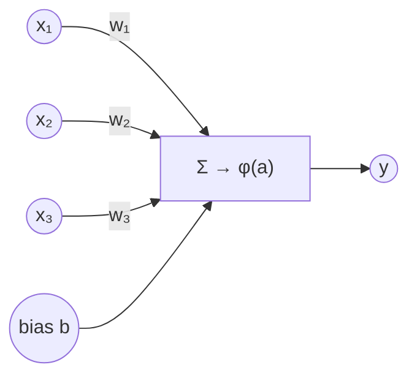
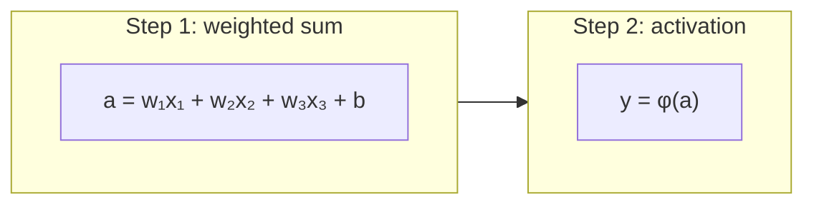
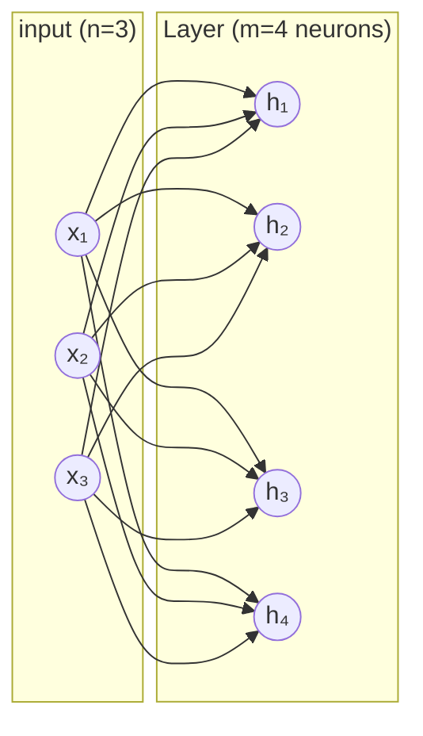
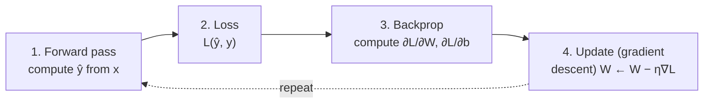

> **AI Generated**

# Neural Network Theory

This document records the conceptual and mathematical foundations of the dense
(fully-connected) neural network.

The material below collects a guided study session covering three linked topics
— the neuron/perceptron, layers and networks, and the training loop — followed
by a curated reference list. It is a pure theory reference: the mathematical
framework it establishes is what future features of this project must conform
to, but no implementation detail belongs here. Math is written KaTeX-style
with `$...$` inline and `$$...$$` display.

## 1. The Neuron / Perceptron

### 1.1 Intuition

A **neuron** (or **perceptron**, its simplest form) is a tiny mathematical
decision-unit: it receives several numbers, assigns each an "importance", adds
them up, and produces an output — but only "fires" strongly if the combined
signal crosses some threshold. It is a crude caricature of a biological neuron:
dendrites are the inputs, synapses carry the importances, the soma performs the
summation, and the axon carries the output.

### 1.2 Structure



Reading left to right: each input $x_i$ is multiplied by a **weight** $w_i$
(the "knob" the network learns), everything is **summed** together with a
**bias** $b$, and the total is passed through an **activation function**
$\varphi$ to produce the output $y$. It is useful to view this as two distinct
steps: a weighted sum followed by an activation.



### 1.3 The maths

Given an input vector $\mathbf{x} \in \mathbb{R}^n$, a weight vector
$\mathbf{w} \in \mathbb{R}^n$ and a scalar bias $b \in \mathbb{R}$:

$$
a = \mathbf{w} \cdot \mathbf{x} + b = \sum_{i=1}^{n} w_i x_i + b
\qquad
y = \varphi(a)
$$

Classically, the *perceptron* uses the **Heaviside step function**:

$$
\varphi(a) =
\begin{cases}
1 & \text{if } a \geq 0 \\
0 & \text{if } a < 0
\end{cases}
$$

Geometric insight worth internalizing: the equation
$\mathbf{w} \cdot \mathbf{x} + b = 0$ defines a **hyperplane** (a line in 2D, a
plane in 3D) that splits input space into two half-spaces. The perceptron is
therefore a **linear classifier** answering "which side of the line is this
point on?". The weights set the orientation of the boundary and the bias shifts
it.

### 1.4 The Rosenblatt learning rule

Frank Rosenblatt's perceptron learns by adjusting the weights whenever it
misclassifies a training example. For an input component $x_i$ with desired
output $d_j$ and actual output $y_j$:

$$
w_i \leftarrow w_i + r\,(d_j - y_j)\,x_i
$$

where $r$ is the **learning rate**. The correction is proportional to the error
$(d_j - y_j)$ and to the input $x_i$: a feature that fired strongly while the
unit was wrong moves the boundary more. The rule provably converges when the
two classes are linearly separable.

### 1.5 Linear separability and the XOR limitation

Because a single perceptron draws one straight decision boundary, it can only
represent **linearly separable** concepts. It learns `AND`, `OR`, and `NOT`
(these all admit a separating line), but **fails on `XOR`**: no single line can
separate the points where $x_1 \oplus x_2 = 1$ from those where it equals 0.

```
XOR truth table (inputs x₁, x₂):        1 = output
        x₂
        1 |  0   |   1
          |      |
        0 |  1   |   0
          +-------------
             0      1   x₁
(no single straight line splits the 1s from the 0s)
```

This limitation (famously highlighted by Minsky and Papert, 1969) is the
historical motivation for **stacking neurons into layers** and inserting
non-linearities, which is the subject of the next section. The fix is not more
weights in one layer but more layers: a two-layer network can carve out the
non-convex region XOR requires.

### 1.6 Activation functions

The perceptron's hard step is not differentiable, which rules out the gradient
-based training used by modern networks (§3). Replacing $\varphi$ with smooth
functions (and later, piecewise-smooth ones) gives the standard menu:

| Function | Formula $\varphi(a)$ | Range | Notes |
|---|---|---|---|
| Step (Heaviside) | $1$ if $a \geq 0$ else $0$ | $\{0, 1\}$ | Original perceptron; not differentiable. |
| Sigmoid | $\dfrac{1}{1 + e^{-a}}$ | $(0, 1)$ | Smooth "soft step"; derivative $\sigma(a)\bigl(1 - \sigma(a)\bigr)$; saturates (vanishing gradients). |
| tanh | $\dfrac{e^{a} - e^{-a}}{e^{a} + e^{-a}}$ | $(-1, 1)$ | Zero-centred sigmoid; derivative $1 - \tanh^2(a)$. |
| ReLU | $\max(0, a)$ | $[0, \infty)$ | Cheap, sparse, eases vanishing gradients; zero gradient for $a < 0$ ("dead" units). |
| Softmax | $\dfrac{e^{z_i}}{\sum_j e^{z_j}}$ | $(0, 1)$, sums to 1 | Turns a vector of scores into a probability distribution; used on the output layer of multi-class networks. |

A smooth activation is what makes the network both **non-linear** (so it can
bend decision boundaries) and **differentiable** (so it can be trained by
gradient descent). Each entry above keeps its own weights and bias but shares
the same choice of $\varphi$.

## 2. Layers and Networks (Dense / Fully-Connected)

### 2.1 From one neuron to a layer

A single neuron computes one number. A **layer** computes $m$ numbers *in
parallel*, each with its own weights and bias, all reading the **same** input
vector. That is what "**dense**" or "**fully connected**" means: every neuron
in the layer sees every component of the input.

The key trick is to stack the $m$ weight vectors as the **rows** of a matrix
$W$, turning the whole layer into a single matrix multiply:

$$
\mathbf{h} = \varphi\!\left(W\,\mathbf{x} + \mathbf{b}\right)
$$

where, for $n$ inputs and $m$ neurons,

$$
W = \begin{pmatrix}
\mathbf{w}_1^{\top} \\ \mathbf{w}_2^{\top} \\ \vdots \\ \mathbf{w}_m^{\top}
\end{pmatrix} \in \mathbb{R}^{m \times n},
\qquad
\mathbf{b} = \begin{pmatrix} b_1 \\ b_2 \\ \vdots \\ b_m \end{pmatrix} \in \mathbb{R}^{m},
\qquad
\mathbf{h} \in \mathbb{R}^{m}
$$

and $\varphi$ is applied **element-wise**. Each layer has
$n \times m + m$ learnable parameters ($nm$ weights plus $m$ biases): the
parameter count grows **quadratically** in the layer widths, which is why width
is a cost to be spent deliberately.



### 2.2 Stacking layers into a network

A **network** is a chain of layers where the output of one becomes the input of
the next. Each step is the **composition of an affine map with a
nonlinearity**:

$$
\mathbf{a}^{(l)} = \varphi\!\left(W^{(l)}\,\mathbf{a}^{(l-1)} + \mathbf{b}^{(l)}\right)
$$

Applying a non-linearity between affine layers is essential. **Why an
all-linear network collapses:** if every $\varphi$ were the identity (i.e. no
activation), two consecutive layers would reduce to a single linear map,

$$
W^{(2)}\!\left(W^{(1)}\mathbf{x}\right) = \left(W^{(2)} W^{(1)}\right)\mathbf{x},
$$

so any depth of purely linear layers is equivalent to **one** linear layer —
it could still only model linear functions, and XOR would remain out of reach.
The non-linearity is exactly what prevents this collapse and lets depth
approximate complex shapes.

### 2.3 MLP terminology

In a **multilayer perceptron (MLP)** the layers have roles:

- The **input layer** holds the raw features $\mathbf{x}$;
- one or more **hidden layers** perform the intermediate nonlinear
  computations;
- the **output layer** produces the prediction $\hat{\mathbf{y}}$.

It is a **feedforward** network: signal flows strictly forward, layer to
layer, with no cycles (as opposed to recurrent networks). The dense
feedforward architecture is the one studied throughout this document.

### 2.4 Universal Approximation Theorem

The **Universal Approximation Theorem** (Cybenko, 1989; Hornik, 1991) states
that a feedforward network with a single hidden layer containing a **sufficient
number of neurons**, and a **non-polynomial** activation function (sigmoid,
tanh, ReLU, ...), can approximate any continuous function on a compact subset
of $\mathbb{R}^n$ to arbitrary accuracy.

Two caveats shape how to read this:

- It is an **existence** statement, not a **learnability** one: it guarantees
  such parameters *exist*, but says nothing about whether gradient descent can
  *find* them, or how many neurons are needed.
- It requires a non-polynomial activation and **sufficient width**; a fixed,
  too-small layer need not approximate well, and polynomial activations break
  the hypothesis.

In practice, *deep* (many narrow) networks are often far more parameter-
efficient than the single wide hidden layer the theorem guarantees.

## 3. Training a Network: Loss → Gradient Descent → Backpropagation

These three pieces form a single closed loop. The **loss** measures *how wrong*
the network is; **gradient descent** says *which way to nudge* the parameters to
be less wrong; **backpropagation** is the *efficient chain-rule trick* to
compute that direction through all the stacked layers.



This is the entire training algorithm; the subsections fill in the three
labelled boxes.

### 3.1 Loss functions ("how wrong am I?")

A **loss function** $L(\hat{\mathbf{y}}, \mathbf{y})$ maps the prediction
$\hat{\mathbf{y}}$ and the true target $\mathbf{y}$ to a single non-negative
number: the cost of being wrong. Training minimises it. The total loss over a
dataset of $N$ examples is the **average** of the per-example losses. Two
families dominate:

**Mean Squared Error (regression).** The quadratic loss; the $\tfrac{1}{2}$ is
there purely so the derivative comes out clean
($\partial L / \partial \hat{y}_k = \hat{y}_k - y_k$):

$$
L(\hat{\mathbf{y}}, \mathbf{y}) = \frac{1}{2}\,\lVert \hat{\mathbf{y}} - \mathbf{y}\rVert^2 = \frac{1}{2}\sum_k (\hat{y}_k - y_k)^2
$$

**Cross-Entropy / log loss (classification).** Measures how "surprised" the
model is by the correct label. For a binary output ($y \in \{0,1\}$ with a
sigmoid probability $\hat{y}$):

$$
L(\hat{y}, y) = -\bigl[\,y \log \hat{y} + (1 - y)\log(1 - \hat{y})\,\bigr]
$$

For $k$ classes with a softmax output $\hat{y}$ and one-hot target $y$, the
**categorical cross-entropy** is

$$
L(\hat{\mathbf{y}}, \mathbf{y}) = -\sum_{c=1}^{k} y_c \log \hat{y}_c
$$

**Requirements on a loss.** To fit this framework a loss must be
(i) **differentiable** so gradients exist, and (ii) **decomposable** as an
average $L = \frac{1}{N}\sum_j L_j$ over individual training examples so the
gradient splits into a sum of per-example gradients (§3.2, §3.3).

### 3.2 Gradient descent ("which way to nudge?")

Gradient descent repeatedly moves every parameter $\theta$ (a weight or bias)
down the gradient of the loss by a step proportional to the **learning rate**
$\eta$:

$$
\theta \leftarrow \theta - \eta\,\nabla L
$$

Intuition: the gradient is the direction of steepest increase, so stepping
against it decreases the loss locally. The **learning rate** controls a
tradeoff — too large overshoots the minimum (diverges), too small crawls (slow
convergence). For real networks the loss surface is **non-convex** (many
parameters, many dimensions), so descent may settle in a local minimum or a
saddle point rather than the global optimum — in high dimensions the latter are
usually the binding difficulty, and mild randomness in the updates helps
escape them.

Three variants differ in how much data each update uses:

| Variant | Data per update | Character |
|---|---|---|
| **Batch** gradient descent | entire training set | exact gradient, slow, stable per-step |
| **Stochastic** GD | a single example | very fast, noisy updates |
| **Mini-batch** GD | a small random subset (e.g. 32–256) | the practical default — balances gradient quality and speed, and vectorises well |

### 3.3 Backpropagation (the efficient chain rule)

Backpropagation is just the **chain rule applied efficiently layer by layer**,
backwards, so intermediate quantities are reused instead of recomputed. Use the
standard per-layer notation, where the superscript $(l)$ indexes the layer:

$$
\mathbf{z}^{(l)} = W^{(l)}\,\mathbf{a}^{(l-1)} + \mathbf{b}^{(l)}
\qquad
\mathbf{a}^{(l)} = \sigma\!\left(\mathbf{z}^{(l)}\right)
$$

Here $\mathbf{z}^{(l)}$ is the pre-activation (weighted sum) and
$\mathbf{a}^{(l)}$ the activated output; $\mathbf{a}^{(0)} = \mathbf{x}$ and
$\mathbf{a}^{(L)} = \hat{\mathbf{y}}$. Define the **error vector**
$\boldsymbol{\delta}^{(l)} = \partial L / \partial \mathbf{z}^{(l)}$. Then the
recurrence is:

**Output-layer error** ($\odot$ is element-wise product,
$\nabla_{\mathbf{a}} L$ the per-component loss gradient w.r.t. the output):

$$
\boldsymbol{\delta}^{(L)} = \nabla_{\mathbf{a}} L \;\odot\; \sigma'\!\left(\mathbf{z}^{(L)}\right)
$$

**Backpropagate the error** to earlier layers:

$$
\boldsymbol{\delta}^{(l-1)} = \left(W^{(l)}\right)^{\top} \boldsymbol{\delta}^{(l)} \;\odot\; \sigma'\!\left(\mathbf{z}^{(l-1)}\right)
$$

**Read off the gradients** at each layer directly from the cached activations:

$$
\frac{\partial L}{\partial W^{(l)}} = \boldsymbol{\delta}^{(l)}\left(\mathbf{a}^{(l-1)}\right)^{\top}
\qquad
\frac{\partial L}{\partial \mathbf{b}^{(l)}} = \boldsymbol{\delta}^{(l)}
$$

Two structural facts matter for any implementation. First, the **forward pass
caches** every $\mathbf{a}^{(l)}$ and $\mathbf{z}^{(l)}$ so the backward pass
can reuse them — this is the memory/time trade at the heart of the algorithm.
Second, the weight gradient is an **outer product** of the error vector with
the layer input ($\boldsymbol{\delta}^{(l)}$ times $\mathbf{a}^{(l-1)}$), which
is exactly what makes it cheap to compute.

### 3.4 The assembled training loop

Putting the three parts together, one training iteration over a mini-batch is:

```text
for each training epoch:
    for each mini-batch B of examples:
        # 1. Forward pass (cache a^(l), z^(l) per layer)
        for l = 1 .. L:
            z^(l) = W^(l) a^(l-1) + b^(l)      # a^(0) = x
            a^(l) = sigma(z^(l))

        # 2. Loss and output error
        loss   = L(a^(L), y)
        delta  = grad_a L  ⊙  sigma'(z^(L))

        # 3. Backward pass (propagate error, accumulate gradients)
        for l = L down to 1:
            dW^(l) = delta  (a^(l-1))^T
            db^(l) = delta
            delta  = (W^(l))^T delta  ⊙  sigma'(z^(l-1))

        # 4. Update (gradient descent)
        for l = 1 .. L:
            W^(l) = W^(l) - eta * dW^(l)
            b^(l) = b^(l) - eta * db^(l)
```

The loop is literally "forward → backward → update", repeated until the loss
stops improving.

## 4. References

Wikipedia:

- [Perceptron](https://en.wikipedia.org/wiki/Perceptron)
- [Artificial neuron](https://en.wikipedia.org/wiki/Artificial_neuron)
- [Multilayer perceptron](https://en.wikipedia.org/wiki/Multilayer_perceptron)
- [Feedforward neural network](https://en.wikipedia.org/wiki/Feedforward_neural_network)
- [Universal approximation theorem](https://en.wikipedia.org/wiki/Universal_approximation_theorem)
- [Loss (machine learning)](https://en.wikipedia.org/wiki/Loss_(machine_learning))
- [Cross entropy](https://en.wikipedia.org/wiki/Cross_entropy)
- [Gradient descent](https://en.wikipedia.org/wiki/Gradient_descent)
- [Stochastic gradient descent](https://en.wikipedia.org/wiki/Stochastic_gradient_descent)
- [Backpropagation](https://en.wikipedia.org/wiki/Backpropagation)

Books and online text:

- Michael Nielsen, *Neural Networks and Deep Learning*,
  [neuralnetworksanddeeplearning.com](https://neuralnetworksanddeeplearning.com/)
  — Chapter 1 ([Using deep networks to classify
  handwritten digits](https://neuralnetworksanddeeplearning.com/chap1.html))
  and Chapter 2 ([How the backpropagation
  algorithm works](https://neuralnetworksanddeeplearning.com/chap2.html)).
- Ian Goodfellow, Yoshua Bengio and Aaron Courville, *Deep Learning* (MIT
  Press, 2016), Chapter 6 — *Deep Feedforward Networks*.
- Roland Rojas, *Neural Networks — A Comprehensive Introduction* (Springer).

Videos:

- 3Blue1Brown, *But what is a neural network?* — the visual series on neural
  networks (YouTube playlist beginning with
  [neural networks](https://www.3blue1brown.com/topics/neural-networks)).
